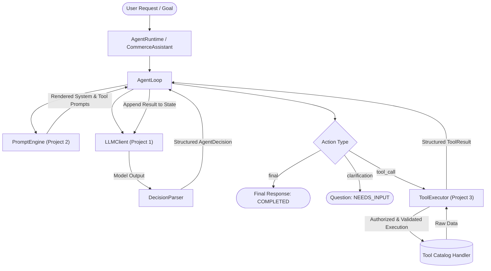

# Architecture: AsuX Agent Runtime V1

The `asux-agent-runtime` is the fourth pillar of the AsuX AI Engineering syllabus. It provides the controlled orchestration layer for a **Single AI Commerce Assistant**.

## Architectural Separation of Concerns
1. **Model Access:** Handled exclusively via `asux-llm-gateway` (Project 1).
2. **Prompts & Templating:** Handled exclusively via `asux-prompt-engine` (Project 2).
3. **Tool Execution & Authorization:** Handled exclusively via `asux-tool-runtime` (Project 3).
4. **Execution Loop & State Management:** Handled exclusively by `asux-agent-runtime` (Project 4).

## Security Boundaries
- **No Arbitrary Code Execution:** The LLM cannot execute arbitrary Python code. It can only propose registered tools.
- **Trusted Identity Context:** Caller identity and permissions reside strictly inside `PermissionContext` passed at invocation time. Model-generated payloads cannot escalate permissions or alter tenant contexts.
- **Authoritative Authorization:** Tools are authorized by Project 3's `PermissionChecker`. The agent loop never bypasses or simulates permissions.
- **Controlled Budgets:** Step limits, tool invocation limits, failure limits, and timeouts prevent infinite loops and runaway costs.
